# Passage Watch

**Choose what your tokenized holding becomes — and know when the route is ready.**

Passage Watch is a read-only outcome planner for self-custody tokenized-stock holders. A holder picks an exact instrument, a quantity, a destination (USDC in a Solana wallet or shares in a brokerage account) and a deadline. Passage compares the relevant routes, their prerequisites, their evidence and their unknowns — then shows what changed since the plan was saved.

It does **not** trade, sign, redeem, determine legal eligibility, or claim guaranteed settlement.

**Track:** Real World Assets · **Hackathon:** Build with CMC, Round 2 (Nov 2026)

**Live demo:** <https://passage-watch.fly.dev/> — scale-to-zero, so the first load can take a few seconds while the machine wakes.

---

## Check it in 60 seconds

1. Open the demo and choose **AAPLX — Apple Inc. (Solana)**.
2. Enter `75` units, set a deadline a couple of days out, and keep the **USDC in my Solana wallet** destination.
3. Select **Check routes**. You get a live sell quote, a **liquidity-at-size** table (25/50/100% of the holding), the route table, and an **exit window** with the next NYSE session and how many sessions remain before your deadline.
4. Switch the destination to **Shares in my brokerage**. xPort changes from *different destination* to a route that requires **both** issuer and Alpaca onboarding.
5. Select **Watch this plan**, re-run a check after prices move, and read **Change since saved** plus the price sparkline.

Everything is real: the identity graph, prices, the Solana multiplier, the sell quote and the daily observation sparkline come from live APIs at request time.

### Feature map

| Area | What it does |
|---|---|
| Identity | CMC resolves the underlying → wrapper token → issuer; Solana contract verified |
| Sell quote | Live read-only Jupiter quote, token → USDC, at your exact size |
| Liquidity at size | The same quote at 25/50/100% of the holding |
| Units | Token-2022 Scaled UI Amount, effective-time multiplier (not the naive field) |
| Routes | Secondary sale / Market Flow / xChange / xPort with prerequisites, unknowns, sources, availability |
| Exit window | Market open/closed now, next session, sessions remaining before your deadline |
| Monitoring | Background snapshot worker + "change since saved" |
| Address import | Paste a Solana address (read-only) to pull supported holdings |
| Trading-desk skin | Dark terminal UI: live UTC clock, NYSE badge, scrolling catalog price tape, quote board, depth-bar liquidity ladder |

---

## What makes this different

Adjacent tools compare wrapper prices (Parity), measure execution cost (Haircut), screen access (Will RWA Let Me In / VaultTerms), or estimate exit capacity (RWA X-Ray). Passage's distinction is narrow and concrete:

> **Given this exact holding and this required end state, which individual process delivers it, what is still unknown, and what changed before my deadline?**

A destination switch changes the answer for a reason the user can understand: stablecoin routes and brokerage-share routes are different processes with different prerequisites.

The product never collapses these into one "redeemable" flag and never declares a global best route.

### How one check runs



### Why the exit window matters



A token can be transferable while the process that turns it into cash or shares is closed. Passage shows **when each route can run** and how many NYSE sessions remain before your deadline — without claiming a settlement guarantee.

---

## Source boundaries

| Layer | What it is | What it is **not** |
|---|---|---|
| Observed market data | CoinMarketCap identity, price and timestamp | Legal rights, NAV, executable liquidity, eligibility |
| Provider quote | Jupiter Swap V2 size-specific read-only estimate | A guaranteed fill or cash received |
| Documented route terms | Published issuer process and conditions | Verification of this user's account access |

A quote is not cash. Brokerage shares are not bank cash. Self-reported onboarding is never an eligibility result. Unknown fields stay unknown.

---

## Live API evidence

All evidence files in [`docs/evidence/`](docs/evidence/) were captured from the running product with the participant's campaign key on 2026-11-18.

### CoinMarketCap endpoints used

| Endpoint | Purpose |
|---|---|
| `/v5/real-world-assets/map` | Resolve underlying stock symbol → `rwa_id` |
| `/v5/real-world-assets/quotes/latest` | Asset → token → issuer graph with observed prices |
| `/v2/cryptocurrency/info` | Solana contract address for exact token identity |
| `/v3/cryptocurrency/quotes/historical` | Real daily price points behind "change since saved" |
| `/v1/key/info` | Quota / entitlement diagnostics |

### Real call (code)

[`src/cmc.rs`](src/cmc.rs) sends the key only from server config, to a fixed host, with an allow-listed endpoint set:

```rust
self.http
    .get(url)
    .header("X-CMC_PRO_API_KEY", &self.key)
    .header("Accept", "application/json")
    .query(params)
    .send()
    .await
```

### Real response (trimmed from `docs/evidence/check-response.json`)

```json
{
  "instrument": {
    "rwa_id": 3,
    "token_symbol": "AAPLX",
    "crypto_id": 36994,
    "issuer": "Backed Assets",
    "contract": "XsbEhLAtcf6HdfpFZ5xEMdqW8nfAvcsP5bdudRLJzJp",
    "unit_basis": "verified",
    "observed_price_usd": 351.36
  },
  "quote": {
    "provider": "Jupiter Swap V2 (read-only)",
    "output_amount": 74.19,
    "output_label": "share-equivalents",
    "is_final": false
  },
  "rule_version": "routes-2026-11-18"
}
```

Run `docs/evidence/reproduce.sh` with your own key to reproduce the calls.

---

## What the API made possible — and where it got in the way

**Made possible.** `quotes/latest` returns the asset → token → issuer graph directly, so Passage can resolve an exact instrument from a ticker and attach each route to that identity. The token `crypto_id` links to `cryptocurrency/info` for the Solana contract and to historical quotes for real observation changes. This mapping would be painful to maintain by hand.

**Friction.** The RWA family has no history endpoint and no per-token underlying-price, NAV, eligibility or unit-ratio field. The RWA market-pairs endpoint is Growth-gated and returns `1006` on event keys. CMC's aggregate `average_tokenized_price` can blend tokens quoted in different units. Passage therefore keeps identity/price and route terms as separate layers, resolves units from the Token-2022 mint on-chain, and refuses to infer redemption rights from price data.

---

## Token units done properly

xStocks on Solana use the Token-2022 **Scaled UI Amount** extension. The active multiplier is not simply the `multiplier` field: a `newMultiplier` becomes active only at `newMultiplierEffectiveTimestamp`. AAPLX, for example, currently carries `multiplier = 1.0032690` and a pending `newMultiplier = 1.0038023`.

Passage reads the mint via Solana `getAccountInfo` with `jsonParsed`, selects the active multiplier against the cluster clock, and converts raw quote units into displayed share-equivalents. If the unit basis cannot be resolved, valuation is suppressed rather than guessed. See [`src/unit.rs`](src/unit.rs) and [`src/rpc.rs`](src/rpc.rs).

---

## Architecture



- No user accounts; the holder's financial inputs stay in browser localStorage.
- No wallet connection, signing, transactions or execution.
- No database service required for the MVP.
- Fixed upstream hosts; no user-supplied URLs; no key or quantity logging.

Full detail: [docs/ARCHITECTURE.md](docs/ARCHITECTURE.md) · [docs/DESIGN.md](docs/DESIGN.md)

---

## Local development

```bash
cp .env.example .env
# put the participant's own campaign key in .env (never commit it)
pnpm install
cargo test

# terminal 1
cargo run
# terminal 2
pnpm dev
```

The Vite dev server proxies `/api` to the Rust service on port 3000. The CMC key is loaded from the `.env` **file** with override, so a stale shell variable cannot be used.

---

## Route documentation

- [xStocks Market Flow](https://docs.xstocks.fi/docs/issuance-and-redemption/market-flow) — $5,000 minimum, 24/5, stablecoin proceeds.
- [xChange atomic RFQ](https://docs.xstocks.fi/docs/issuance-and-redemption/atomic-rfq-xchange) — onboarded clients, variable spread, ~60s window; route minimum not published.
- [xPort in-kind](https://docs.xstocks.fi/docs/issuance-and-redemption/in-kind-flow-xport) — issuer and Alpaca onboarding, shares not cash.
- [Jupiter Swap V2 order](https://developers.jup.ag/docs/api-reference/swap/order.md) — quote-only request (no `taker`).

---

## Honest limitations

- Route evidence is curated and dated; conditions can change and a stale registry is flagged, not silently trusted.
- No authenticated issuer quotes, so issuer-route proceeds and availability remain unknown.
- The audience is narrow: holders actually weighing stablecoin liquidity against brokerage shares.
- The keyless quote is unauthenticated and shared-rate-limited; display terms still need confirmation.
- This is not financial, legal or tax advice.

See [docs/STATUS.md](docs/STATUS.md) for current build state and [docs/SUBMISSION.md](docs/SUBMISSION.md) for the submission checklist.

## Licence

Implementation code is dual-licensed MIT / Apache-2.0. Third-party data and issuer documentation remain subject to their own terms; no CMC dataset is redistributed through this repository.
